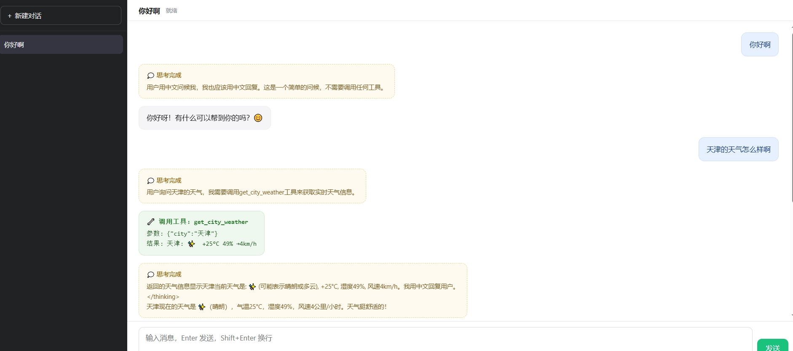

# 简介
一个基于Python实现的pi-agent-core核心代码的二次开发项目。可自行注册业务所需的tool供agent调用.

读者需自行评估python和typescript的运行性能差异。





本仓库的实现有：
- [x] pi统一打包本地源码安装，可以直接`from pi.py_ai import *`使用所需的包，详见`pi/`目录
- [x] 增加一个可以多轮运行的示例, 包含模型注册、工具注册、skills加载 `hello_agent_loop.py`
- [x] 更多真实的Tool的注册， 增加 get_city_weather、web_search 真实tool，以及read,write,bash等7个内置操作。详见`pi/pi_tools/`目录
- [x] Skill的加载, 集成 Skill 加载系统和3个初始 skill, 详见`.pi/skills/`目录
- [ ] Extension加载
- [x] 运行时compact
- [ ] session持久化，对话恢复
- [x] 增加`docs/`目录，python代码解读


# 立刻运行agent_loop项目
``` shell
git clone https://github.com/wqzh/hello-pypi.git && cd hello-pypi

# 本地源码安装，-e 参数，允许你修改'pi/'目录下的源码，立即生效
pip install -e pi

cp .env.example .env
# 必须修改.env中3个变量： PI_LLM_BASE_URL、PI_LLM_MODEL_ID 、PI_LLM_API_KEY

# 单agent,多轮对话
python hello_agent_loop.py

```


# 运行 Web 聊天界面

```shell
conda activate zwq-kit
python hello_agent_loop_web.py
# 浏览器打开 http://127.0.0.1:8000
```

可用环境变量：`PI_WEB_HOST`（默认 `127.0.0.1`）、`PI_WEB_PORT`（默认 `8000`）。

Web 相关代码全部位于 `web/`，便于维护：

```
web/
├── app.py        FastAPI 路由、WebSocket、Origin 校验
├── sessions.py   会话状态、展示消息、JSONL 持久化、多连接广播
├── events.py     Agent 事件 → 前端 JSON 协议
├── agent.py      Agent 工厂、上下文压缩
├── config.py     路径 / 模型 / 工具 / 提示词
└── static/
    ├── index.html
    ├── app.css
    └── app.js
```

界面能力：会话列表与搜索、欢迎页快捷卡片、流式输出、可折叠思考过程、
工具调用卡片（状态 / 耗时 / 参数 / 结果折叠与复制、天气专用卡）、停止生成、断线重连。


# 存在问题 TODO
1. web_search() 无法理解‘今天’、‘最近’的具体时间含义，读者需自行去除时间指代的歧义
2. get_city_weather(), 目前只支持获取指定城市的实时天气，明天、几天后的天气 需自行实现
3. compaction: prompt方法结束后才压缩。中途某一步可能就超出token限制了. 是否要调整压缩的位置？？


# 本地源码安装
```shell
# 重新安装（修改依赖后）DEBUG mode：
pip install -e pi

#生产部署：去掉 -e 参数
pip install pi

# 卸载：
pip uninstall pi

```


# 致谢
- 本仓库参考了 [encyc/pi-py 仓库](https://github.com/encyc/pi-py) pi(v0.84.1)核心模块 的python实现.

- https://github.com/earendil-works/pi
- https://github.com/encyc/pi-py

# 许可证
MIT

