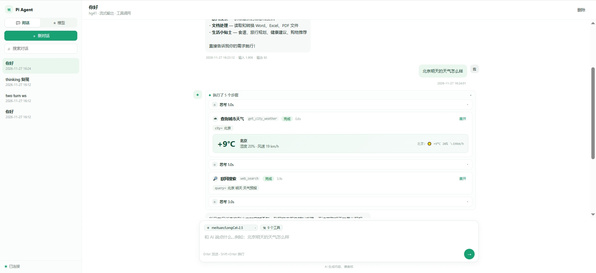

<p align="center">
  <a href="./README.md">中文</a> | <a href="./README_EN.md">EN</a>
</p>


# 简介
一个基于Python实现的pi-agent-core核心代码的二次开发项目。可自行注册业务所需的tool供agent调用.

读者需自行评估python和typescript的运行性能差异。





本仓库的实现有：
- [x] pi统一打包本地源码安装，可以直接`from pi.py_ai import *`使用所需的包，详见`pi/`目录
- [x] 增加一个可以多轮运行的示例, 包含模型注册、工具注册、skills加载，CMD黑框交互 `hello_agent_loop.py`
- [x] 增加一个可以多轮运行的web示例, 包含模型注册、工具注册、skills加载、session加载等，web交互 `hello_agent_loop_web.py`
- [x] 更多真实的Tool的注册， 增加 get_city_weather、web_search 真实tool，以及read,write,bash等7个内置操作。详见`pi/pi_tools/`目录
- [x] Skill的加载, 集成 Skill 加载系统和3个初始 skill, 详见`.pi/skills/`目录
- [ ] Extension加载
- [x] 运行时compact
- [x] session持久化，对话恢复. 会话历史将保存在 本项目的`.pi/sessions/`下，详见`hello_agent_loop_web.py`
- [x] 增加`docs/`目录，python代码解读


# 立刻运行agent_loop项目
``` shell
git clone https://github.com/wqzh/hello-pypi.git && cd hello-pypi

# 本地源码安装，-e 参数，允许你修改'pi/'目录下的源码，立即生效
pip install -e pi

cp .env.example .env
# 必须修改.env中3个变量： PI_LLM_BASE_URL、PI_LLM_MODEL_ID 、PI_LLM_API_KEY

# 必要时 pip install -r requirements.txt

# 单agent,多轮对话
python hello_agent_loop.py    # cmd interaction

python hello_agent_loop_web.py  # local web interaction
```


# 运行 Web 聊天界面

```shell
conda activate zwq-kit
python hello_agent_loop_web.py
# 浏览器打开 http://127.0.0.1:8000
```

可用环境变量：`PI_WEB_HOST`（默认 `127.0.0.1`）、`PI_WEB_PORT`（默认 `8000`）。

Web 相关代码全部位于 `web/`，便于维护：

```
web/
├── app.py        FastAPI 路由、WebSocket、Origin 校验
├── sessions.py   会话状态、展示消息、JSONL 持久化、多连接广播
├── events.py     Agent 事件 → 前端 JSON 协议（含 token / 缓存统计）
├── agent.py      Agent 工厂、模型切换、上下文压缩
├── config.py     路径 / 模型注册表 / 工具 / 提示词
└── static/
    ├── index.html
    ├── app.css
    └── app.js
```

界面能力：会话列表与搜索（卡片显示年月日-时分，最近交互排最前）、欢迎页快捷卡片、
流式输出、中间步骤（思考 + 工具调用）折叠区、每条消息的时间与 token/缓存命中统计、
模型下拉切换、工具清单弹层、停止生成、断线重连。

左侧「模型」页列出所有已加载模型，每行一个，行尾「测试连接」可探测可用性，
支持「全部测试」；结果显示 HTTP 状态码（401 鉴权失败 / 403 无权限 / 404 接口不存在 /
429 限流 / ERR 连接失败）、耗时与命中的鉴权方式。

每行还有「获取模型」按钮：直接 `GET {BASE_URL}/models`，展开该地址下可用的模型列表
（id + owned_by），同样支持三种鉴权依次尝试。

思考型模型（如 LongCat-2.5）的 `reasoning_content` 会实时流式显示在折叠区，思考结束后立即折叠；
若某轮只返回思考而没有正文，会展开思考并给出明确提示，不再出现“界面一片空白”。

鉴权自动兼容两类服务：先试 `Authorization: Bearer <KEY>`，再试裸 `Authorization: <KEY>`，
最后试 `api-key: <KEY>`；`/models` 不可用时退回 `/chat/completions`
（`max_tokens=1`）。超时可用 `PI_MODEL_TEST_TIMEOUT`（默认 15 秒）调整。

## 配置多个模型

在 `.env` 中用 `PI_MODELS` 声明模型键，每个键对应一组 `PI_MODEL_<KEY>_*` 变量：

```ini
PI_MODELS=qwen35,deepseek
PI_DEFAULT_MODEL=qwen35          # 可选，不填则取第一个

PI_MODEL_QWEN35_NAME=Qwen3-35B
PI_MODEL_QWEN35_MODEL_ID=qwen3-35b-a3b-gguf
PI_MODEL_QWEN35_BASE_URL=http://127.0.0.1:9978/v1
PI_MODEL_QWEN35_API_KEY=sk-xxx
PI_MODEL_QWEN35_PROVIDER=wqzh-local

PI_MODEL_DEEPSEEK_NAME=DeepSeek-Chat
PI_MODEL_DEEPSEEK_MODEL_ID=deepseek-chat
PI_MODEL_DEEPSEEK_BASE_URL=https://api.deepseek.com/v1
PI_MODEL_DEEPSEEK_API_KEY=sk-yyy
PI_MODEL_DEEPSEEK_PROVIDER=deepseek
```

下拉框显示的名称是「供应商/模型名」：供应商取 `PROVIDER`（留空则取 `BASE_URL` 的主机名），
模型名取 `NAME`（留空则取 `MODEL_ID`）。每个会话独立记忆所选模型并写入会话元数据，
重启后自动恢复。未配置 `PI_MODELS` 时仍按旧的 `PI_LLM_*` 单模型配置运行。


# 存在问题 TODO
1. web_search() 无法理解‘今天’、‘最近’的具体时间含义，读者需自行去除时间指代的歧义
2. get_city_weather(), 目前只支持获取指定城市的实时天气，明天、几天后的天气 需自行实现
3. compaction: prompt方法结束后才压缩。中途某一步可能就超出token限制了. 是否要调整压缩的位置？？


# 本地源码安装
```shell
# 重新安装（修改依赖后）DEBUG mode：
pip install -e pi

#生产部署：去掉 -e 参数
pip install pi

# 卸载：
pip uninstall pi

```


# 致谢
- 本仓库参考了 [encyc/pi-py 仓库](https://github.com/encyc/pi-py) pi(v0.84.1)核心模块 的python实现.

- https://github.com/earendil-works/pi
- https://github.com/encyc/pi-py

# 许可证
MIT

